<div align="center">


# Kiwi Music Player

A music streaming app for Android with playlists, offline downloads and in-app chat, built with Kotlin and Jetpack Compose.


</div>

## About

Kiwi is a Spotify-style music player we built as a team for our Android course. Songs and playlists are streamed from a Supabase backend, while accounts, likes, follows and chat history are stored on the device.

## Screenshots

<table>
  <tr>
    <td align="center">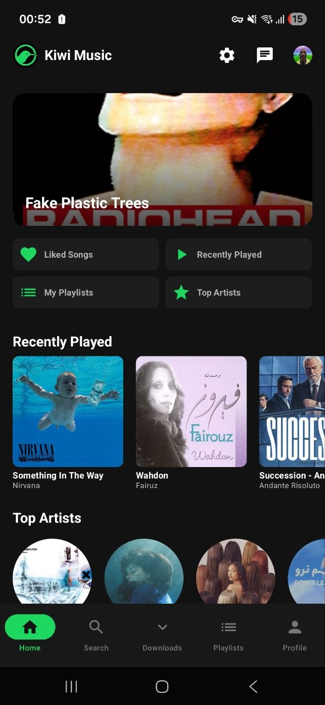<br /><b>Home</b></td>
    <td align="center">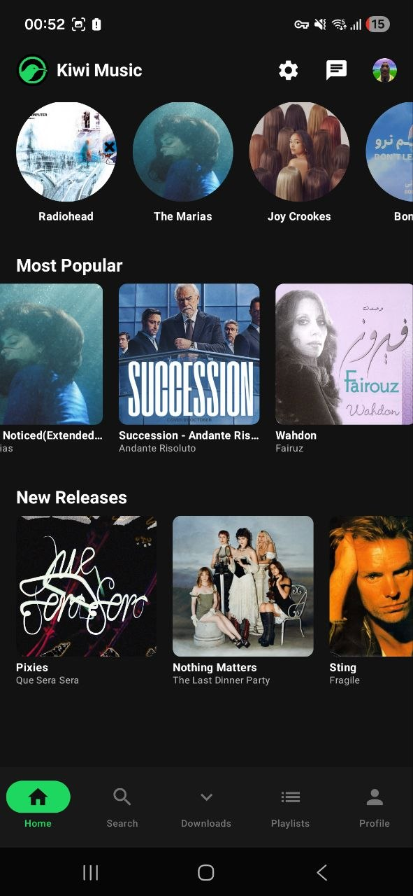<br /><b>Discover</b></td>
    <td align="center">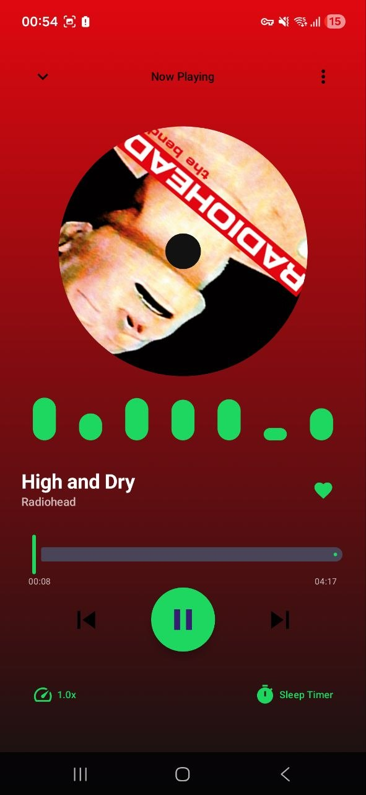<br /><b>Now Playing</b></td>
  </tr>
  <tr>
    <td align="center">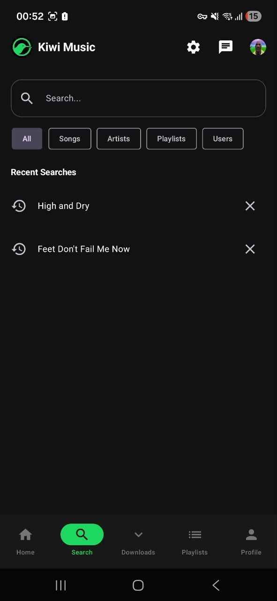<br /><b>Search</b></td>
    <td align="center">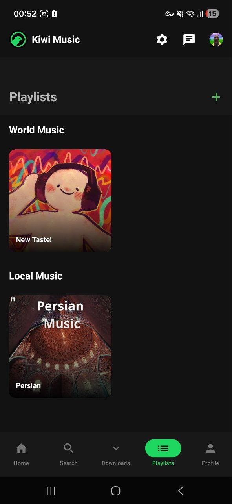<br /><b>Playlists</b></td>
    <td align="center">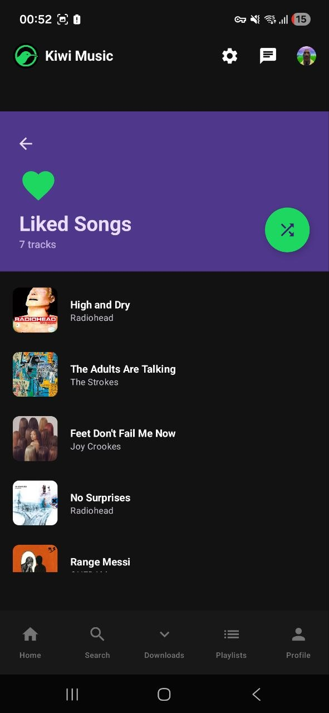<br /><b>Liked Songs</b></td>
  </tr>
  <tr>
    <td align="center">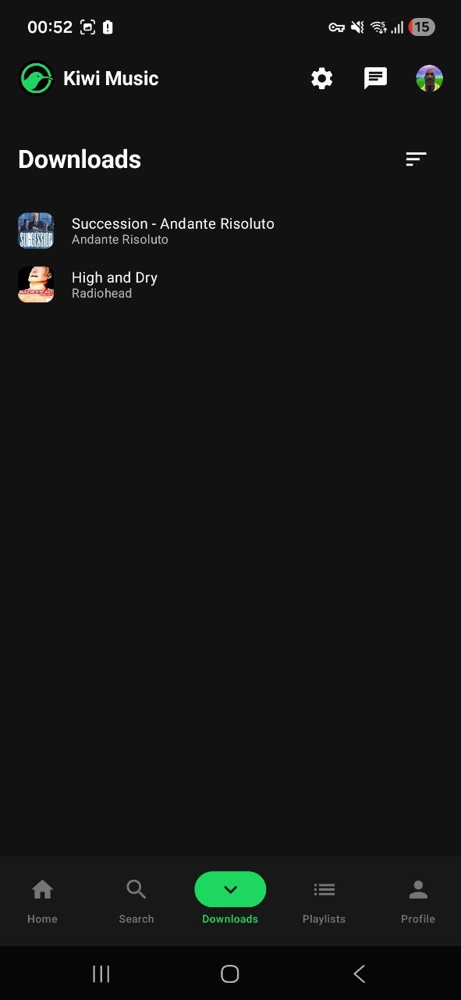<br /><b>Downloads</b></td>
    <td align="center">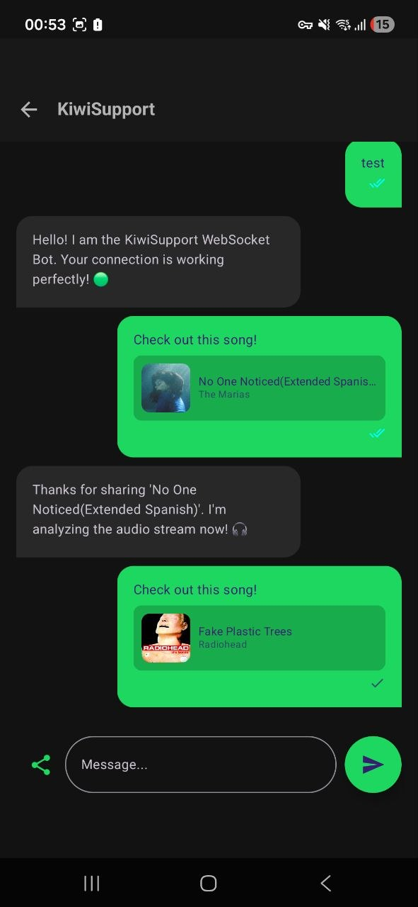<br /><b>Chat</b></td>
    <td align="center">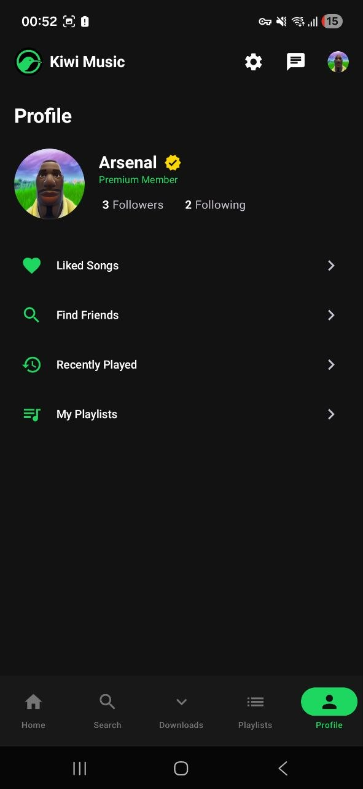<br /><b>Profile</b></td>
  </tr>
  <tr>
    <td align="center">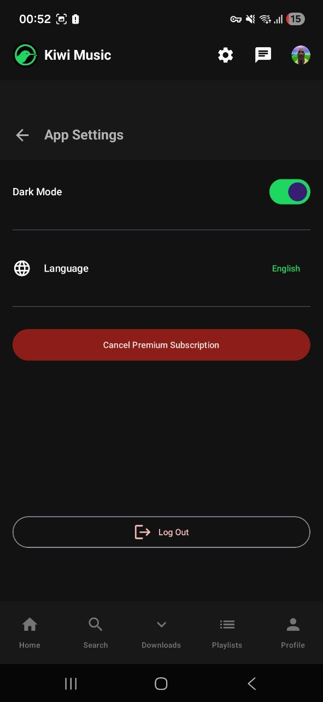<br /><b>Settings</b></td>
    <td align="center">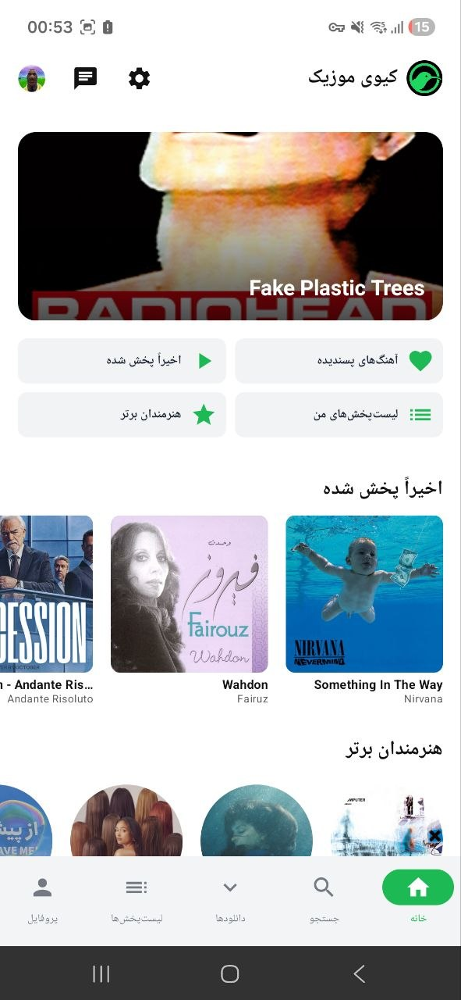<br /><b>Persian (RTL), light theme</b></td>
    <td align="center">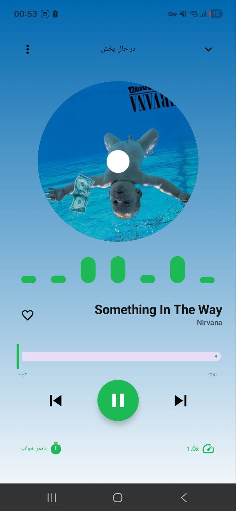<br /><b>Now Playing in Persian</b></td>
  </tr>
</table>

## Features

**Playback**
- Streaming with Media3 ExoPlayer and a background media service
- Full-screen player with a background gradient taken from the album art
- Audio visualizer, sleep timer and playback speed control
- Mini player that stays available across the app

**Library**
- Home sections for recently played, top artists, most popular and new releases
- Search across songs, artists, playlists and users, with search history
- Liked songs and playlists
- Offline downloads with WorkManager, available to premium users

**Social**
- User profiles with followers and following
- Find friends and follow them
- Chat over WebSocket, with song sharing and message status ticks

**Personalization**
- Dark and light themes
- English and Persian, with right-to-left layout

## Tech Stack

| Area | Libraries |
|---|---|
| Language and UI | Kotlin 2.0.21, Jetpack Compose, Material 3, Navigation Compose |
| Dependency injection | Hilt 2.51.1 |
| Local storage | Room 2.6.1, DataStore Preferences |
| Backend | Supabase 2.5.0 (Postgrest, Storage), Ktor |
| Playback | Media3 ExoPlayer and MediaSession 1.4.0 |
| Background work | WorkManager |
| Lists and images | Paging 3, Coil 2.6.0, Palette |
| Chat | OkHttp WebSocket |

## Architecture

The app follows MVVM, with screens sending intents to ViewModels that expose state from repositories.

```text
app/src/main/java/com/example/kiwi/
├── data/           Room database, paging sources, WebSocket client, repository implementation
├── domain/         Models and repositories
├── presentation/   Compose screens, components, navigation, theme and ViewModels
├── playback/       Media service and audio cache
├── worker/         Background downloads
└── di/             Hilt modules
```

## Getting Started

**Requirements:** Android Studio, JDK 21 and Android SDK 35. The app runs on Android 7.0 (API 24) and above.

```bash
git clone https://github.com/ArianArsenal/Kiwi-Music-Player.git
cd Kiwi-Music-Player
./gradlew assembleDebug
```

You can also open the project in Android Studio and run the `app` configuration on a device or emulator.

## Known Limitations

This is a course project and isn't intended for production use.

- **Chat needs a separate server.** The WebSocket server isn't part of this repository, and its address is hardcoded in `ChatWebSocketManager.kt` as `ws://192.168.1.3:8080/chat`.
- **Accounts are local.** They exist only on the device, and passwords are stored unhashed, so don't use a real password.
- **Premium is simulated.** It's a local flag with no real payments.

## Team

- [Arian Mohseni](https://github.com/ArianArsenal)
- [Armina Motaghi](https://github.com/Arminamotaghi)
- [mHoseinFayaz](https://github.com/mHoseinFayaz)

## License

Released under the [GNU General Public License v3.0](LICENSE).
